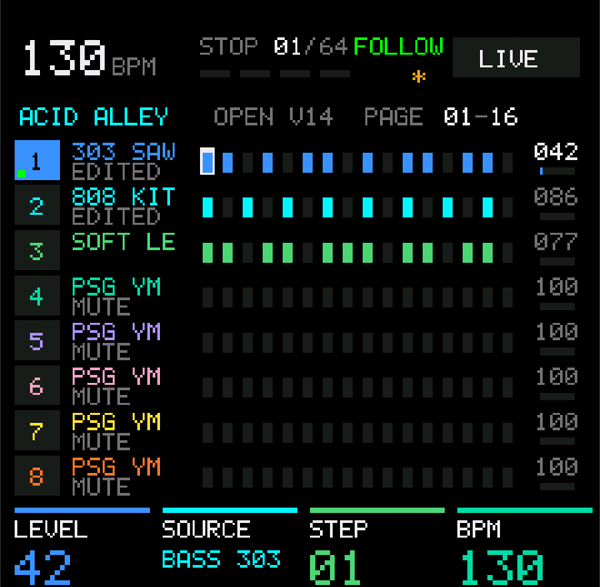
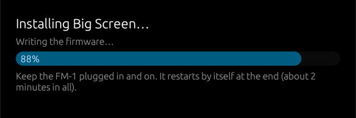

# FM-1 Big Screen: the M-VAVE FM-1's screen, big

*Formerly called FM-1 Mirror: same app, new name.*

☕ If this helps you make music, you can [buy me a coffee on Ko-fi](https://ko-fi.com/aikellogg).

The M-VAVE FM-1 is a wonderful little FM synth, but its screen is only 1.54 inches across. If your
eyes aren't what they were, it's hard to read. **FM-1 Big Screen shows the FM-1's screen on your
computer, tablet or phone, as big as you like**: the whole window or the whole monitor, sharp, in colour, or in
high-contrast looks such as yellow on black.

It's live. Turn a knob, press a button, play a note, and the big screen changes with the little one. From 1.3.18 it also has a built-in **Mellotron** (flute, strings, choir) that the FM-1's keys play, out of the computer.

It also plays the FM-1 from a keyboard (**Keys**) and shows the notes and chords you play in a
**spyglass** beside the screen, and on a Mac it works over **Bluetooth** as well as USB.

Free, for **Mac, Windows and Linux**, and on **Android** as
[FM-1 Big Screen + Spyglass](https://github.com/pfkellogg/fm1-mirror-spyglass-android) (the same app for tablets and
phones).

**Watch it:** [FM-1 Mirror's Big Update: Smooth, a Floating Spyglass, and Melodee on a Big Screen](https://youtu.be/Cve21r8oZJs): Smooth, the floating spyglass, the firmware name and Melodee on a Big Screen.

Questions, or something not working? Write to me:
**pfkellogg@gmail.com**

**No FM-1?** [MIDI Spyglass](https://github.com/pfkellogg/midi-spyglass) is the spyglass on its own, for any MIDI keyboard: the notes and chords, the staff, the waveform, and FROM → TO pairs that play your synths (Mac, Windows, Linux and Android; [video](https://youtu.be/GMLf3W4oTp4)).

## What's new about it

The FM-1 doesn't normally share its screen with anything. What I added is a small piece of intelligence inside its
firmware: **the FM-1 sends its display only when my app asks for it.** About once a second the app says "I'm watching";
while it does, the FM-1 sends each part of the screen it redraws, and when the app goes quiet the FM-1 stops. With no app
asking it sends nothing, and it plays exactly as before.

That's why the firmware matters: the regular releases of SLOOP, JIANT, Melodee and the others don't have this part, so
there's nothing to show. Their **Big Screen** versions are the same firmwares with this one small addition (free, MIT
licensed, so any firmware author can include it; it's offered to M-VAVE, SLOOP, Erik37 and NACHTFAHRT).

On the other end, my app catches the screen and makes it readable: as big as you like, smoothed and sharpened, in
high-contrast colours if you want, with the spyglass for notes and chords beside it. FM-1 Big Screen runs on Mac, Windows,
Linux and Android, and iPhone and iPad are coming.

## Download

Click the file for your computer. These links always give the newest version.

**Two versions: Basic and Max.** From 1.3.20 every computer has both. Pick one; either can replace the other later.

- **Max (with Mellotrons)**: everything, with a Mellotron's **flute, strings and choir built in**, ready to play from the
  FM-1's keys. About 35 MB (Linux 48 MB).
- **Basic**: bare bones, just the big screen, the spyglass and the built-in piano. About 8 MB (Linux 20 MB). No Mellotron sounds
  inside, but it can **download them** (and every new one we make) whenever you want: click the **Mellotron** button.

In the files, Basic is the one ending in **-lite**.

| Computer | Max (with Mellotrons) | Basic | First time you open it |
|---|---|---|---|
| Mac (Apple silicon and Intel) | [**FM-1-Mirror-mac.zip**](https://github.com/pfkellogg/fm1-mirror/releases/latest/download/FM-1-Mirror-mac.zip) | [**FM-1-Mirror-mac-lite.zip**](https://github.com/pfkellogg/fm1-mirror/releases/latest/download/FM-1-Mirror-mac-lite.zip) | Double-click the zip to unzip it, drag **FM-1 Big Screen** (the app, with the FM-1 Big Screen name) to Applications and open it. It isn't from the App Store, so the first time macOS may refuse: open **System Settings → Privacy & Security**, scroll down and click **Open Anyway** next to FM-1 Big Screen. |
| Windows 10 and 11 | [**FM-1-Mirror-windows.exe**](https://github.com/pfkellogg/fm1-mirror/releases/latest/download/FM-1-Mirror-windows.exe) | [**FM-1-Mirror-windows-lite.exe**](https://github.com/pfkellogg/fm1-mirror/releases/latest/download/FM-1-Mirror-windows-lite.exe) | Double-click. If Windows says "protected your PC", click **More info → Run anyway**. |
| Linux | [**FM-1-Mirror-linux**](https://github.com/pfkellogg/fm1-mirror/releases/latest/download/FM-1-Mirror-linux) | [**FM-1-Mirror-linux-lite**](https://github.com/pfkellogg/fm1-mirror/releases/latest/download/FM-1-Mirror-linux-lite) | `chmod +x` the file and run it. |
| Android (tablet, phone or Fire TV Stick 4K) | [**FM-1 Big Screen + Spyglass**](https://github.com/pfkellogg/fm1-mirror-spyglass-android), also in Basic and Max (from 1.5.0 also Android 7.1 and a Fire TV Stick 4K, with a built-in piano; from 1.5.4 it also finds an FM-1 running Erik37) | Its own page, with the download and how to plug it in. |

> **Not the green "Code" button.** GitHub's green **Code → Download ZIP** button at the top of this
> page gives the app's source code (a folder called `fm1-mirror-master`), which doesn't run. Use the
> links above, or **Releases** on the right of the page.

Plug the FM-1 into the computer with a USB **data** cable (some cables only charge), turn it on, and
open FM-1 Big Screen.

**On Android:** see [FM-1 Big Screen + Spyglass](https://github.com/pfkellogg/fm1-mirror-spyglass-android).

## How it works, in plain words

The FM-1 doesn't normally tell a computer what's on its screen. So the FM-1 needs slightly different
firmware (the software inside it) that does.

- **M-VAVE's Open firmware.** In October 2026 M-VAVE made the FM-1's firmware *open*: they published
  its source code so the community can improve it, plus a free web page, the
  [FM1 Workbench](https://open.m-vave.com/fm1-workbench), that installs it. That's called "Official
  Open firmware", and it's M-VAVE's own.
- **FM-1 Big Screen firmware.** This is M-VAVE's Open firmware with one small addition: while FM-1
  Mirror is running, the FM-1 also sends its screen to the computer over the same USB cable it already
  uses for MIDI. When nothing is asking, it sends nothing, and the FM-1 plays exactly as before.
  ([The source code and what changed.](https://github.com/pfkellogg/fm1_open/blob/screen-out/BIG_SCREEN.md))
- **FM-1 Big Screen** asks for the screen about once a second and draws it big.

Everything else about the FM-1 is M-VAVE's Open firmware: its sounds, sequencer and menus.

## Setting it up

FM-1 Big Screen walks you through this itself. Open it with the FM-1 plugged in and it tells you which
firmware your FM-1 has and what to do next.

**If your FM-1 still has the firmware it came with (most FM-1s), it's two steps:**

1. **Put M-VAVE's Official Open firmware on it, on M-VAVE's own page.** In Chrome or Edge, open the
   [FM1 Workbench](https://open.m-vave.com/fm1-workbench) and go to **Device update**.
   Open **Recovery & force update**, tick **Force flash (migrate from other firmware)**, click
   **Connect device**, tick **I have backed up…** and click **Force flash**. Allow MIDI access if
   Chrome asks. It takes about two minutes and the FM-1 restarts by itself.
   - This replaces the FM-1's sounds with M-VAVE's factory sounds. If you made your own, save them
     first: the page's **Projects & sounds** tab can read and export each group of 32 voices as a
     `.syx` file, and load them back afterwards with **Replace this group…**.
2. **Install Big Screen from FM-1 Big Screen.** Back in FM-1 Big Screen, click **Install Big Screen…**, then
   **Install now**. A progress bar shows how it goes; it takes a minute or two and the FM-1 restarts
   by itself. Your sound library stays (save any unsaved work on the FM-1 first, as with any update).

**If your FM-1 already runs M-VAVE's Open firmware**, only step 2.

**On Android**, step 2 works the same in FM-1 Big Screen + Spyglass. Step 1 is easiest on a computer: the
workbench page needs Chrome or Edge, and then the FM-1 goes back on the tablet for step 2.

Keep the FM-1 plugged in and turned on while either step runs. On Windows, close other music apps
that use the FM-1 first (Windows lets only one app use a MIDI device at a time).

## Going back is easy

Nothing here is permanent, and you don't need FM-1 Big Screen to undo it. M-VAVE's own
[FM1 Workbench](https://open.m-vave.com/fm1-workbench) can put either of their firmwares back,
whenever you like, the same way as step 1:

- **Back to M-VAVE's Official Open firmware:** Device update → tick **I have backed up…** →
  Connect device → **Start update**.
- **Back to the original firmware the FM-1 came with:** Device update → **Recovery & force update**
  → **Restore original V15** → Connect device → tick **I have backed up…** → **Install original V15**.
  That also puts back the 128 factory sounds.

If an update is ever interrupted (a cable pulled out, the computer asleep, the computer losing the
FM-1 while it restarts into its updater), nothing is broken: the FM-1 waits in its updater for the
rest of the firmware. Plug it back in if it came out and open FM-1 Big Screen: it says **The FM-1 is
waiting in its updater** and **Finish installing Big Screen** carries on from there. M-VAVE's page,
or M-Upgrade, can finish it too.

If the computer keeps losing the FM-1 during Step 2:

- Close every other app that uses the FM-1 first (a DAW, Synth Spyglass, M-VAVE's page in a browser
  tab). On Windows only one app can use it at a time, and the FM-1 reappears under a new name partway
  through the update, so another app can grab it.
- Plug the FM-1 straight into the computer, not through a hub, with a USB data cable.

Coming from M-VAVE's **V16** firmware: the FM-1 keeps V16's updater, which names itself `ota-FM-1_016`. FM-1 Big Screen
1.3.0 / FM-1 Big Screen + Spyglass 1.4.0 and later find it; **older versions looked only for V15's updater**, said the
connection was lost partway through Step 2, and left the FM-1 waiting in its updater (M-Upgrade or M-VAVE's page
finishes it). With an older version, put the original V15 back first (Recovery & force update › Restore original V15).
Thanks to a viewer who reported it.

Tested on a real FM-1 that had been on V16 (2026-11-04): V16, then Official Open, then FM-1 Big Screen 1.3.0 installed Big Screen with no lost connection. Installing Big Screen replaces V16: V16 is closed source, so the screen can't be added to it. The results, and two M-Upgrade problems with their fixes, are in [docs/V16-TEST.md](docs/V16-TEST.md). Watch it: [Every M-VAVE FM-1 Firmware Explained, and What Happened When We Tested V16](https://youtu.be/WOjvFdw5KMA).

If M-Upgrade says "invalid device information", unplug other MIDI gear such as a 2-port keyboard, then restart M-Upgrade.

## Using FM-1 Big Screen

- **F**: full screen (Esc to leave). Drag the window to another monitor or a TV first if you like.
- **M**, or **Hide mirror** in the bar: hides the FM-1's screen, to keep only the spyglass. **Show mirror** brings it back.
- **S**, or **Smooth: off / on** in the bar: takes the jaggies off the FM-1's text and lines (on to begin with, every time FM-1 Big Screen starts). It's a smoothed copy, so turning it off shows exactly what the FM-1 sends. From 1.3.9 it's smooth *and* sharp: a Lanczos enlargement and a sharpening, so letters stay crisp, also on firmwares that shade their screens with dots (Erik37); 1.3.10 sharpens more firmly.
- **Looks**: Color, Bright color (lifts dark text and lines, like purple on black, so they can be read; from 1.3.16 it leaves pictures, panels and dotted backgrounds in their own colours, so Erik37's piano isn't washed out), Yellow on black, White on black, Black on white.
- The buttons hide after a few seconds so the screen is as big as it can be; move the mouse to bring
  them back.
- When a newer Big Screen firmware comes with a new FM-1 Big Screen, a button offers to update the FM-1.
  Bluetooth needs the Big Screen build from FM-1 Big Screen 1.2 or later: an older one sends its screen
  over USB only.
- **Keys**: a keyboard plugged into the computer plays the FM-1 through FM-1 Big Screen. It's picked by
  itself (a keyboard first, not an audio interface's MIDI port); choose another (or **None**) in the
  Keys menu. **Send on** picks the channel: **channel 1** by default, where the FM-1 listens (a keyboard
  knocked onto another channel would be silent); another channel for a firmware that listens there
  ([ChoralRoot's MIDI Keys](https://github.com/pfkellogg/ChoralRootFM1/blob/big-screen/BIG_SCREEN.md#playing-it-from-a-usb-keyboard),
  for its chord engine); or **as they come**. SysEx is never passed on. If another app (MIDI Bridge, Synth
  Spyglass) also plays the FM-1 from the same keyboard, set Keys to **None**, or you'll hear notes twice.
  **The show goes on** (since the 2026-11-10 source): the keyboard opens with or without an FM-1, so the spyglass
  shows what you play even before the FM-1 is plugged in, and plays the FM-1 the moment it arrives (FM-1 Big Screen
  looks every second). With the spyglass on, no "Waiting" panel covers it: a line says the FM-1's screen shows
  when it's plugged in. With the spyglass off, the panel says **No FM-1 yet**.
- **Spyglass**: a round brass eyepiece over the screen with the note or chord you play (the pitch to one decimal, "C4 261.6 Hz"), on a staff,
  and how hard you hit the key. On top of it, the **sound playing** (`T1 FM6 ICE BELL`), when the firmware
  says it: [JIANT FM + Big Screen](https://github.com/pfkellogg/JIANT/blob/big-screen/BIG_SCREEN.md) and
  [Melodee + Big Screen](https://github.com/pfkellogg/melodee/blob/big-screen/BIG_SCREEN.md) do, others don't yet (then there's nothing on top). Drag it to move it; drag the brass grip on its rim, or scroll over it, to resize it; **Spyglass** in the
  bar puts it away. **Float** lifts it out of the window into one of its own, see-through and on top of other windows, and it keeps going when FM-1 Big Screen is minimized. The FM-1's own keys show too, once **KEY OUT** is on: on the FM-1, press **SEQ**,
  turn **ALGO** to page **6/8 MIDI TRACK**, and turn **K4 (KEY OUT)** to **ON** (K3, OUT PORT, on
  USB+BLE).
  From 1.3.2 a note or chord clears 3 seconds after the last key comes up, leaving empty staves over "play a note".
  From 1.3.6 the glass is clean (no dot of light at its top left), and the Mac app has its own icon.
  From 1.3.7 the Mac app keeps its own icon in the Dock while it runs (before, it turned into an "e").
  From 1.3.8, with the spyglass floating, a click on the Dock icon brings back the minimized FM-1 Big Screen window (before, only the spyglass came back).
  From 1.3.13, with a community firmware's regular release (SLOOP, JIANT FM, Melodee, ChoralRoot, Skiff, Erik37, NACHTFAHRT, LOOM-8), FM-1 Big Screen names it and says what to do: install its Big Screen version (a button opens its download page), since the regular release doesn't send its screen.
  From 1.3.12 the Mac window's title bar is solid, so its "FM-1 Big Screen" title is clear (before, it was drawn over whatever was behind the window), and Smooth is on every time FM-1 Big Screen starts.
  From 1.3.3 it also shows the **waveform** of the FM-1's real sound beside the staff, over USB (not Bluetooth). A Mac asks once to use the microphone, because it counts any audio input as one: FM-1 Big Screen listens only to the FM-1. It finds the FM-1's sound by its name, also, from 1.3.11, when a community firmware names it after itself (Erik37's is "ERIK37"; SLOOP, Skiff and LOOM-8 too).
- **Mellotron**, from 1.3.18 (and Android 1.6.8): the **Mellotron** button in the bar steps through a built-in Mellotron's **flute**, **strings** and **choir**, then off (remembered). The FM-1's own keys play it (its KEY OUT on; SLOOP sends its keys as it comes), and so does a keyboard plugged into the computer: while the Mellotron is on, the keyboard's notes play it instead of the FM-1 (its knobs and pedal still go to the FM-1). The sound comes out of the computer (the default output, never the FM-1's own USB audio). Like the real one, every key has its own 8-second tape strip (35 keys, G2 to F5) that runs out if held longer, with no velocity; the spyglass shows who's playing ("FM-1 → Mellotron flute", or the keyboard's name from 1.3.19, "Keystation 49 MK3 → Mellotron strings") and the Mellotron's real waveform. **Mellotron sounds** (from 1.3.20): right-click the Mellotron button (or, in Basic with none yet, click it) for the list of sounds online; click **Download** next to one, or **Remove** next to a downloaded one. New sounds are added to that list (in the Android repo's sounds/sounds.json), so they arrive without an update; the app goes online only for that list and those downloads. To record a demo, `FM1_MELLOTRON_OUTPUT=BlackHole` (any part of an output's name) sends the Mellotron to that output without changing the Mac's sound settings. Why in the app and not in the FM-1: the FM-1 has 1 MB of flash for everything, and one Mellotron sound is about 25 MB. The three sounds are made from scratch by programs (no recordings: the Android repo's tools/make_mellotron_*.py), free to use in your own music. The flute is now **v7** (2026-11-23): less hiss, a reedier low end, livelier vibrato; Basic downloads it as the new flute (version 2 in the sounds list), and the [Mellotron Flute Lab](https://aikellogg.com/#/flute-lab) puts its whole recipe on sliders. Video: [A Mellotron on the M-VAVE FM-1's keys](https://youtu.be/xG2tBLl4yOA) (on Android).
- **No sound?** A keyboard's volume slider (a Keystation has one) sets the FM-1's volume: keep it up.
- **An old firmware's name on a Mac?** macOS remembers a USB MIDI device by its USB IDs and port, and keeps its first name: after a new firmware, every app may still show the old one ("ChoralRoot FM-1" for LOOM-8). From 1.3.5, FM-1 Big Screen gives it back the name the FM-1 reports, for every app on the Mac (M-Flasher too).
- **The bottom bar** names the firmware the FM-1 says it runs ("FM-1: SLOOP 2.8.4"), from 1.3.1. A Mac can remember an older name for the FM-1's port ("ChoralRoot FM-1" on an FM-1 now running SLOOP), and earlier versions showed that. Firmware that doesn't say, like M-VAVE's Open, still shows the port's name.

**Over Bluetooth (Mac):** the FM-1's Bluetooth MIDI has to be on (on the FM-1, hold **HOME** and
press **GLO**: **K1 BLUETOOTH ON**, **K3 BLE ROLE DEVICE**). Then once, in **Audio MIDI Setup**,
**Window › Show MIDI Studio**, click the **Bluetooth** button and **Connect** next to **FM1
Community_BLE**; FM-1 Big Screen finds it by itself (the bottom bar says "FM1 Community_BLE Bluetooth").
It's slower than USB but follows the screen well. USB comes first whenever the FM-1 is plugged in,
and firmware is only ever installed over USB. The FM-1 takes one Bluetooth connection at a time, so
close FM-1 Big Screen on the tablet before connecting the Mac, and the other way round.

**On Android**, [FM-1 Big Screen + Spyglass](https://github.com/pfkellogg/fm1-mirror-spyglass-android) does all of this on a tablet or phone,
Bluetooth included. Watch it: [FM-1 Mirror + Spyglass for Android](https://youtu.be/XDqrabQf5uY).

Also playing it from a USB keyboard? [Synth Spyglass](https://youtu.be/KoUeE4bOoy0) (a separate
app) recognises the Big Screen FM-1 too, shows the name of the sound it's playing, and has a **See
big screen** button of its own.

## Other firmwares: ChoralRoot, JIANT FM and Skiff

The screen messages work with any FM-1 firmware that sends them (the screen part is MIT). The first community firmware
with it: **ChoralRoot + FM-1 Big Screen** ([pfkellogg/ChoralRootFM1](https://github.com/pfkellogg/ChoralRootFM1/blob/big-screen/BIG_SCREEN.md)),
Quixotic7's chord instrument with 32 lines added. Over USB; "Update FM-1" doesn't show on it (it would replace it).

The second: **JIANT FM + FM-1 Big Screen** ([pfkellogg/JIANT](https://github.com/pfkellogg/JIANT/blob/big-screen/BIG_SCREEN.md)),
juanjiant's music system (synths, drums, a sequencer, songs), V10.49 with 38 lines added. Also over USB only, and
"Update FM-1" doesn't show on it either. JIANT has daily builds; ours stays at V10.49 until the screen is added to a newer one. Watch it: [JIANT FM on a Big Screen](https://youtu.be/7o5s0EDJX5c).
JIANT also says which sound is playing, shown on top of the spyglass, and the app finds it by its own USB name,
"JIANT" (both since 1.3.0; earlier versions kept waiting for the FM-1).

The third: **Skiff + FM-1 Big Screen** ([pfkellogg/skiff](https://github.com/pfkellogg/skiff/blob/big-screen/BIG_SCREEN.md)),
illuminus5's six-track groovebox, Skiff 2.1.1 with about 37 lines added, and the sound playing on the spyglass too. USB only.
All three come from Leo Kuroshita's Felucca, and so do 23 of the 25 most popular FM-1 firmwares
([FIRMWARE_FAMILY.md](https://github.com/pfkellogg/skiff/blob/big-screen/FIRMWARE_FAMILY.md)). Watch it: [Skiff on a Big Screen + the FM-1 Firmware Family Tree](https://youtu.be/lmMT-FtAoSE).

The fourth: **[SLOOP + FM-1 Big Screen](https://github.com/pfkellogg/sloop-fm1/blob/big-screen/BIG_SCREEN.md)**, isod89's live groovebox and the most starred FM-1 firmware, SLOOP 2.8.5 with about 40 lines added, and the sound playing on the spyglass too. Tested on a real FM-1 (2026-11-07) on a Mac. Download it from its [Releases](https://github.com/pfkellogg/sloop-fm1/releases). Watch it: [SLOOP on a Big Screen](https://youtu.be/Pd4Bm6JvtkU).

The fifth: **[Melodee + FM-1 Big Screen](https://github.com/pfkellogg/melodee/blob/big-screen/BIG_SCREEN.md)**, keremimo's multi-engine synth and sequencer, Melodee 1.6.1 with the mirror added, and the sound playing on the spyglass too. USB only. Tested on a real FM-1 (2026-11-07) on a Mac and an Android tablet. Download it from its [Releases](https://github.com/pfkellogg/melodee/releases). Plain Melodee doesn't send its screen: it's fine to keep using it, and you only need this build to see it here. Watch it: [FM-1 Mirror's Big Update: Smooth, a Floating Spyglass, and Melodee on a Big Screen](https://youtu.be/Cve21r8oZJs).

The sixth: **[Erik37 + FM-1 Big Screen](https://github.com/pfkellogg/erik37/blob/big-screen/BIG_SCREEN.md)**, genkigenki's grand piano firmware, Erik37 1.3 with the mirror added, and the sound playing on the spyglass too. USB only (Erik37 builds without Bluetooth). Tested on a real FM-1 (2026-11-14). The code is public; there's no download while it's offered to genkigenki ([pull request #13](https://github.com/genkigenki/erik37/pull/13)). Watch it: [FM-1 Big Screen: Sharper Text, Erik37's Damper Sound, and Coming to iPhone & iPad](https://youtu.be/S677yseRAsM).

The seventh: **[NACHTFAHRT + FM-1 Big Screen](https://github.com/pfkellogg/fm1-nachtfahrt/blob/big-screen/BIG_SCREEN.md)**, Cranky Man's generative Berlin School instrument, NACHTFAHRT 1.0 with the mirror added, and the piece playing on the spyglass. USB only. Tested on a real FM-1 (2026-11-17). The code is public; no download while it's offered to Cranky Man ([pull request #9](https://github.com/FartyPants/fm1-nachtfahrt/pull/9)). Its sibling NACHTBAR (a tenor sax in a late-night jazz bar) hasn't published its source yet; it's asked for ([issue #3](https://github.com/FartyPants/fm1-nachtbar/issues/3)) so it can get the same. Watch it: [NACHTBAR, and NACHTFAHRT on a Big Screen (Before/After)](https://youtu.be/TzhZUkLPeHU).

**Built in by its author.** **[Skiff Atlatl](https://github.com/LIkst4/skiff-atlatl)** 1.2 by LIkst4, a six-track groovebox forked from Skiff, has the screen part in its own release: install it as it is, from its [Releases](https://github.com/LIkst4/skiff-atlatl/releases), and FM-1 Big Screen shows it big. No Big Screen version needed. Thank you, LIkst4! Tested on a real FM-1 (2026-11-21). The app names it "Skiff Atlatl" from Mac 1.3.15 and Android 1.6.5 (earlier versions call it "Skiff").

**Sweeten** (from 1.3.22 and Android 1.6.13): the **Sweeten** button beside the FM-1 and Mellotron lights makes the Mellotron sound the way a good stereo does: a little warmth and air, soft tape saturation, stereo width (a slow chorus) and a small room. Remembered. The same recipe is on the [Flute Lab](https://aikellogg.com). Video, with real recordings of the Mellotron flute squeezed into 79 KB on the FM-1 itself: [A Mellotron Flute Squeezed into 79 KB on the M-VAVE FM-1](https://youtu.be/I_IcpR6xEdA).

**Big Knobs and Key Lights** (from 1.3.23; Android 1.6.14): two buttons on the bar, both remembered. **Knobs** shows the FM-1's eight knobs big (SELECT, ALGORITHM, KNOB 1–4, PRESETS and MASTER): drag one (up or right is clockwise) or scroll on it, and the real one turns; MASTER holds until you move the FM-1's own MASTER knob. **Lights** shows the FM-1's 14 buttons and 27 keys big, lit when they're lit on the FM-1 (bright amber) and glowing when they glow (soft amber), so you can see them while your fingers cover the real ones; and the notes you're playing (the FM-1's keys, or a keyboard through Keys) in blue, folded onto the FM-1's keys by octaves. They need firmware that speaks them: Charles Vestal's fm1-base firmwares with their mirror on (Polly, LOOM-8 and others: his mirror already sends its lights and takes remote turns, thank you Charles), and the new Big Screen builds made with Big Knobs and Key Lights (coming soon on [aikellogg.com](https://aikellogg.com)). With other firmware the knobs do nothing and the strip shows only the notes you play. **Click or hold** a button or key on the strip (from 1.3.24) and the real one is pressed, holds and combinations too (FX plus a key, say).

**The way to a Big Screen firmware** (from 1.3.25; Android 1.6.15): an FM-1 whose firmware has no Big Screen shows **You need to install a Big Screen firmware of your choice** with a big button to [aikellogg.com › Make a Big Screen](https://aikellogg.com/#/make-big-screen) (pick any FM-1 firmware from The Firmware Hub, get it with Big Screen, Big Knobs and Key Lights); **No FM-1 yet** has that button too. A firmware with the older Big Screen (the screen only, no Key Lights) shows, in the strip's place, that its new version brings Big Knobs and Key Lights, with the same button.

**Big Screen version 2.** David Konsumer's [bigscreen.h](https://github.com/konsumer/foma/tree/main/bigscreen) (MIT) is the next version of the Big Screen protocol: the FM-1 sends only the parts of the screen that changed, compressed, and says when a frame is whole, so the picture never shows half a frame (about 0.7 KB a frame instead of 1.8 KB, and half the lag). FM-1 Big Screen asks for version 2 first and falls back to version 1 by itself, so every Big Screen firmware keeps working; firmware using bigscreen.h (fomajam, and the ones that switch to it) shows whole frames. Thank you, David! (Not yet tested on a real FM-1 sending version 2; our decoder matches bigscreen.h's own output pixel for pixel.)

**Firmware built on fm1-base, with its own mirror.** Charles Vestal's [fm1-base](https://github.com/charlesvestal/fm1-base) has a screen mirror of its own (his protocol, not Big Screen's). From 1.3.17 (and Android 1.6.7) FM-1 Big Screen understands it too, so firmware built on fm1-base with that mirror turned on (`mirror = true`) shows big with nothing else to install, for example Polly, LOOM-8, Ocarina, Mutable Dreams, ECHOFIELD, JAMTRACK, Kris Jangle and LOAF BREAKER. Thank you, Charles! Tested on a real FM-1 with Polly 0.6.4 (2026-11-21) on a Mac and a Fire TV Stick.

**Offered to the authors.** The screen part is offered to each firmware's own author, so it can be in their official releases: M-VAVE's Official Open ([m-vave/fm1_open#24](https://github.com/m-vave/fm1_open/pull/24), tested on a real FM-1), SLOOP ([isod89/sloop-fm1#263](https://github.com/isod89/sloop-fm1/pull/263)), Erik37 ([#13](https://github.com/genkigenki/erik37/pull/13)) and NACHTFAHRT ([#9](https://github.com/FartyPants/fm1-nachtfahrt/pull/9)). Melodee's author is happy with the separate build (no room in Melodee itself for now).

**The spyglass works with any firmware.** It needs no change to the firmware and no Big Screen: it shows the notes played through FM-1 Big Screen (a keyboard on **Keys**), on the staff, with the waveform of the FM-1's real sound. With a firmware that doesn't send its screen (NACHTBAR, say) the spyglass still works. On its own, for any MIDI keyboard, it's [MIDI Spyglass](https://github.com/pfkellogg/midi-spyglass).

**LOOM-8** ([Charles Vestal's groovebox](https://github.com/charlesvestal/fm1-loom)) mirrors its own screen: from LOOM-8 0.13, its [Mirror page](https://charlesvestal.github.io/fm1-loom/mirror/) (Chrome or Edge, over USB) shows it and lets you play the panel from there. It speaks its own messages, not FM-1 Big Screen's, and there's no Big Screen build of it here: Charles prefers one LOOM-8, so use its page.

With Keys on SLOOP, a keyboard plays track 1 only: FM-1 Big Screen sends it on channel 1, while the FM-1's own keys play the selected track. Tested 2026-11-04: on track 1 both play the same sound. To have the keyboard follow the selected track, SLOOP's manual gives GLO > MIDI 2 > IN = CH 1 (not tested yet).

### Newer FM-1s (a different flash chip)

FM-1s sold from late 2026 have a different memory chip (UCUN UC25HQ80, ID `0xB36014`; the first ones have a Puya P25Q80,
`0x856014`). You can't tell them apart by the logo or the colour: [M-Flasher](https://github.com/jvitkauskas/m-flasher) reads the chip and says which one yours has.
On a newer FM-1:

- **SLOOP + Big Screen** (2.8.5), **Melodee + Big Screen** (1.6.1) and **Erik37 + Big Screen** (1.3) know the new chip: saving works.
- **NACHTFAHRT** (and so NACHTFAHRT + Big Screen) has a report on its own tracker that it doesn't work properly on newer FM-1s.
- **ChoralRoot, JIANT FM and Skiff + Big Screen** don't know it yet. They don't damage anything, but they keep your
  work in memory only: it's gone when you switch off, and installing another firmware from them may fail. Their own
  authors have fixed it (ChoralRoot 0.32, Skiff 2.2, JIANT in its newest test builds), and these Big Screen builds will
  follow. Until then, on a newer FM-1, use those firmwares without the big screen, or SLOOP or Melodee with it.
- If an FM-1 doesn't start after an install, [M-Flasher](https://github.com/jvitkauskas/m-flasher) or M-VAVE's recovery can put a firmware back.

Not yet tested by us on a newer FM-1 (2026-11-08).

## For the curious

- `src/keys.rs`: Keys (the keyboard passed on to the FM-1) and what's been played; `src/glass.rs`:
  the spyglass; `src/chord.rs`, `src/staff.rs`, `src/glyphs.rs`: chord names and the staff, from
  Synth Spyglass.
- `src/screen.rs`: the screen messages. The computer sends `F0 7D 'F' 'S' 00 F7` about once a second
  (`01` to have the whole screen sent again); the FM-1 sends each row it paints as
  `F0 7D 'F' 'S' 01 row col <runs> F7`, each run a count and an RGB565 colour.
  Firmware that knows it also sends the sound playing as `F0 7D 'F' 'S' 02 <name> F7` (ASCII), after each
  hello and whenever it changes; `F0 7D 'F' 'S' 02 F7` asks for only that, without the screen.
  `F0 7D 'F' 'L' 01 F7` asks a firmware of the Felucca family its name (its editor's INFO): the answer starts with
  `FELUCCA SLOOP 2.8.4`, or `FELUCCA v2.1.1` from Skiff, told from Felucca by its identity (`FM-1_7xx`).
- `src/install.rs`: the installer, a port of M-VAVE's own web updater (`sdk/WebUpdate.js` in their
  source): the FM-1's updater asks for each block of the firmware and checks it itself.
- `firmware/`: the Big Screen firmware package this app installs, and its build identity. Built from
  [pfkellogg/fm1_open, branch `screen-out`](https://github.com/pfkellogg/fm1_open/tree/screen-out).
- `tools/simulate_fm1.py`: a pretend FM-1 for trying the app without one;
  `tools/flash_fm1.py`: the installer as a script.
- The Android app, FM-1 Big Screen + Spyglass, has its own repository:
  [pfkellogg/fm1-mirror-spyglass-android](https://github.com/pfkellogg/fm1-mirror-spyglass-android).

Build it yourself with Rust: `cargo build --release` (on Linux, install `libasound2-dev` first);
on a Mac, `./make_app.sh` makes the app.

## Thanks

To M-VAVE for opening the FM-1's firmware ([FM1 Open](https://github.com/m-vave/fm1_open)). The Big
Screen firmware is their work with a small addition; it's not an official M-VAVE product, and
M-VAVE doesn't support it.

## License

GPL-3.0 (see LICENSE), like M-VAVE's FM1 Open application code it builds on.

Contact: **pfkellogg@gmail.com**
