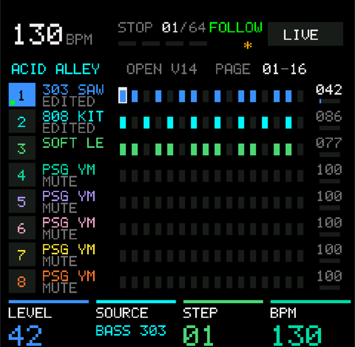
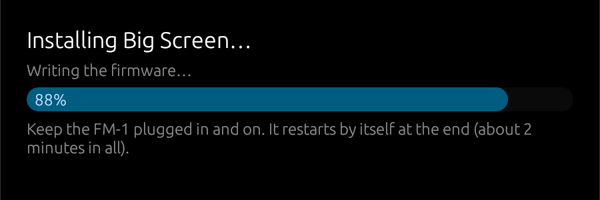

# FM-1 Mirror: the M-VAVE FM-1's screen, big

The M-VAVE FM-1 is a wonderful little FM synth, but its screen is only 1.54 inches across. If your
eyes aren't what they were, it's hard to read. **FM-1 Mirror shows the FM-1's screen on your
computer, tablet or phone, as big as you like**: the whole window or the whole monitor, sharp, in colour, or in
high-contrast looks such as yellow on black.

It's live. Turn a knob, press a button, play a note, and the big screen changes with the little one.

It also plays the FM-1 from a keyboard (**Keys**) and shows the notes and chords you play in a
**spyglass** beside the screen, and on a Mac it works over **Bluetooth** as well as USB.

Free, for **Mac, Windows and Linux**, and on **Android** as
[FM-1 Mirror + Spyglass](https://github.com/pfkellogg/fm1-mirror-spyglass-android) (the same app for tablets and
phones). Questions, or something not working? Write to me:
**pfkellogg@gmail.com**

## Download

Click the file for your computer. These links always give the newest version:

| Computer | File | First time you open it |
|---|---|---|
| Mac (Apple silicon and Intel) | [**FM-1-Mirror-mac.zip**](https://github.com/pfkellogg/fm1-mirror/releases/latest/download/FM-1-Mirror-mac.zip) | Double-click the zip to unzip it, drag **FM-1 Mirror** (the app, with the FM-1 Mirror name) to Applications and open it. It isn't from the App Store, so the first time macOS may refuse: open **System Settings → Privacy & Security**, scroll down and click **Open Anyway** next to FM-1 Mirror. |
| Windows 10 and 11 | [**FM-1-Mirror-windows.exe**](https://github.com/pfkellogg/fm1-mirror/releases/latest/download/FM-1-Mirror-windows.exe) | Double-click. If Windows says "protected your PC", click **More info → Run anyway**. |
| Linux | [**FM-1-Mirror-linux**](https://github.com/pfkellogg/fm1-mirror/releases/latest/download/FM-1-Mirror-linux) | `chmod +x FM-1-Mirror-linux` and run it. |
| Android 11 or newer (tablet or phone) | [**FM-1 Mirror + Spyglass**](https://github.com/pfkellogg/fm1-mirror-spyglass-android) | Its own page, with the download and how to plug it in. |

> **Not the green "Code" button.** GitHub's green **Code → Download ZIP** button at the top of this
> page gives the app's source code (a folder called `fm1-mirror-master`), which doesn't run. Use the
> links above, or **Releases** on the right of the page.

Plug the FM-1 into the computer with a USB **data** cable (some cables only charge), turn it on, and
open FM-1 Mirror.

**On Android:** see [FM-1 Mirror + Spyglass](https://github.com/pfkellogg/fm1-mirror-spyglass-android).

## How it works, in plain words

The FM-1 doesn't normally tell a computer what's on its screen. So the FM-1 needs slightly different
firmware (the software inside it) that does.

- **M-VAVE's Open firmware.** In October 2026 M-VAVE made the FM-1's firmware *open*: they published
  its source code so the community can improve it, plus a free web page, the
  [FM1 Workbench](https://open.m-vave.com/fm1-workbench), that installs it. That's called "Official
  Open firmware", and it's M-VAVE's own.
- **FM-1 Big Screen firmware.** This is M-VAVE's Open firmware with one small addition: while FM-1
  Mirror is running, the FM-1 also sends its screen to the computer over the same USB cable it already
  uses for MIDI. When nothing is asking, it sends nothing, and the FM-1 plays exactly as before.
  ([The source code and what changed.](https://github.com/pfkellogg/fm1_open/blob/screen-out/BIG_SCREEN.md))
- **FM-1 Mirror** asks for the screen about once a second and draws it big.

Everything else about the FM-1 is M-VAVE's Open firmware: its sounds, sequencer and menus.

## Setting it up

FM-1 Mirror walks you through this itself. Open it with the FM-1 plugged in and it tells you which
firmware your FM-1 has and what to do next.

**If your FM-1 still has the firmware it came with (most FM-1s), it's two steps:**

1. **Put M-VAVE's Official Open firmware on it, on M-VAVE's own page.** In Chrome or Edge, open the
   [FM1 Workbench](https://open.m-vave.com/fm1-workbench) and go to **Device update**.
   Open **Recovery & force update**, tick **Force flash (migrate from other firmware)**, click
   **Connect device**, tick **I have backed up…** and click **Force flash**. Allow MIDI access if
   Chrome asks. It takes about two minutes and the FM-1 restarts by itself.
   - This replaces the FM-1's sounds with M-VAVE's factory sounds. If you made your own, save them
     first: the page's **Projects & sounds** tab can read and export each group of 32 voices as a
     `.syx` file, and load them back afterwards with **Replace this group…**.
2. **Install Big Screen from FM-1 Mirror.** Back in FM-1 Mirror, click **Install Big Screen…**, then
   **Install now**. A progress bar shows how it goes; it takes a minute or two and the FM-1 restarts
   by itself. Your sound library stays (save any unsaved work on the FM-1 first, as with any update).

**If your FM-1 already runs M-VAVE's Open firmware**, only step 2.

**On Android**, step 2 works the same in FM-1 Mirror + Spyglass. Step 1 is easiest on a computer: the
workbench page needs Chrome or Edge, and then the FM-1 goes back on the tablet for step 2.

Keep the FM-1 plugged in and turned on while either step runs. On Windows, close other music apps
that use the FM-1 first (Windows lets only one app use a MIDI device at a time).

## Going back is easy

Nothing here is permanent, and you don't need FM-1 Mirror to undo it. M-VAVE's own
[FM1 Workbench](https://open.m-vave.com/fm1-workbench) can put either of their firmwares back,
whenever you like, the same way as step 1:

- **Back to M-VAVE's Official Open firmware:** Device update → tick **I have backed up…** →
  Connect device → **Start update**.
- **Back to the original firmware the FM-1 came with:** Device update → **Recovery & force update**
  → **Restore original V15** → Connect device → tick **I have backed up…** → **Install original V15**.
  That also puts back the 128 factory sounds.

If an update is ever interrupted (a cable pulled out, the computer asleep, the computer losing the
FM-1 while it restarts into its updater), nothing is broken: the FM-1 waits in its updater for the
rest of the firmware. Plug it back in if it came out and open FM-1 Mirror: it says **The FM-1 is
waiting in its updater** and **Finish installing Big Screen** carries on from there. M-VAVE's page,
or M-Upgrade, can finish it too.

If the computer keeps losing the FM-1 during Step 2:

- Close every other app that uses the FM-1 first (a DAW, Synth Spyglass, M-VAVE's page in a browser
  tab). On Windows only one app can use it at a time, and the FM-1 reappears under a new name partway
  through the update, so another app can grab it.
- Plug the FM-1 straight into the computer, not through a hub, with a USB data cable.

Coming from M-VAVE's V16 firmware is fine: Step 1 replaces it completely, so there's no need to go
back to V15 first.

## Using FM-1 Mirror

- **F**: full screen (Esc to leave). Drag the window to another monitor or a TV first if you like.
- **Looks**: Color, Bright color (lifts dark colours like purple so they can be read), Yellow on black, White on black, Black on white.
- The buttons hide after a few seconds so the screen is as big as it can be; move the mouse to bring
  them back.
- When a newer Big Screen firmware comes with a new FM-1 Mirror, a button offers to update the FM-1.
  Bluetooth needs the Big Screen build from FM-1 Mirror 1.2 or later: an older one sends its screen
  over USB only.
- **Keys**: a keyboard plugged into the computer plays the FM-1 through FM-1 Mirror. It's picked by
  itself (a keyboard first, not an audio interface's MIDI port); choose another (or **None**) in the
  Keys menu. **Send on** picks the channel: **channel 1** by default, where the FM-1 listens (a keyboard
  knocked onto another channel would be silent); another channel for a firmware that listens there
  ([ChoralRoot's MIDI Keys](https://github.com/pfkellogg/ChoralRootFM1/blob/big-screen/BIG_SCREEN.md#playing-it-from-a-usb-keyboard),
  for its chord engine); or **as they come**. SysEx is never passed on. If another app (MIDI Bridge, Synth
  Spyglass) also plays the FM-1 from the same keyboard, set Keys to **None**, or you'll hear notes twice.
- **Spyglass**: a round brass eyepiece over the screen with the note or chord you play, on a staff,
  and how hard you hit the key. On top of it, the **sound playing** (`T1 FM6 ICE BELL`), when the firmware
  says it: [JIANT FM + Big Screen](https://github.com/pfkellogg/JIANT/blob/big-screen/BIG_SCREEN.md) does,
  others don't yet (then there's nothing on top). Drag it to move it; scroll over it to resize it; **Spyglass** in the
  bar puts it away. The FM-1's own keys show too, once **KEY OUT** is on: on the FM-1, press **SEQ**,
  turn **ALGO** to page **6/8 MIDI TRACK**, and turn **K4 (KEY OUT)** to **ON** (K3, OUT PORT, on
  USB+BLE).
- **No sound?** A keyboard's volume slider (a Keystation has one) sets the FM-1's volume: keep it up.

**Over Bluetooth (Mac):** the FM-1's Bluetooth MIDI has to be on (on the FM-1, hold **HOME** and
press **GLO**: **K1 BLUETOOTH ON**, **K3 BLE ROLE DEVICE**). Then once, in **Audio MIDI Setup**,
**Window › Show MIDI Studio**, click the **Bluetooth** button and **Connect** next to **FM1
Community_BLE**; FM-1 Mirror finds it by itself (the bottom bar says "FM1 Community_BLE Bluetooth").
It's slower than USB but follows the screen well. USB comes first whenever the FM-1 is plugged in,
and firmware is only ever installed over USB. The FM-1 takes one Bluetooth connection at a time, so
close FM-1 Mirror on the tablet before connecting the Mac, and the other way round.

**On Android**, [FM-1 Mirror + Spyglass](https://github.com/pfkellogg/fm1-mirror-spyglass-android) does all of this on a tablet or phone,
Bluetooth included. Watch it: [FM-1 Mirror + Spyglass for Android](https://youtu.be/XDqrabQf5uY).

Also playing it from a USB keyboard? [Synth Spyglass](https://youtu.be/KoUeE4bOoy0) (a separate
app) recognises the Big Screen FM-1 too, shows the name of the sound it's playing, and has a **See
big screen** button of its own.

## Other firmwares: ChoralRoot and JIANT FM

The screen messages work with any FM-1 firmware that sends them (the screen part is MIT). The first community firmware
with it: **ChoralRoot + FM-1 Big Screen** ([pfkellogg/ChoralRootFM1](https://github.com/pfkellogg/ChoralRootFM1/blob/big-screen/BIG_SCREEN.md)),
Quixotic7's chord instrument with 32 lines added. Over USB; "Update FM-1" doesn't show on it (it would replace it).

The second: **JIANT FM + FM-1 Big Screen** ([pfkellogg/JIANT](https://github.com/pfkellogg/JIANT/blob/big-screen/BIG_SCREEN.md)),
juanjiant's music system (synths, drums, a sequencer, songs), V10.49 with 38 lines added. Also over USB only, and
"Update FM-1" doesn't show on it either. JIANT has daily builds; ours stays at V10.49 until the screen is added to a newer one. Watch it: [JIANT FM on a Big Screen](https://youtu.be/7o5s0EDJX5c).

## For the curious

- `src/keys.rs`: Keys (the keyboard passed on to the FM-1) and what's been played; `src/glass.rs`:
  the spyglass; `src/chord.rs`, `src/staff.rs`, `src/glyphs.rs`: chord names and the staff, from
  Synth Spyglass.
- `src/screen.rs`: the screen messages. The computer sends `F0 7D 'F' 'S' 00 F7` about once a second
  (`01` to have the whole screen sent again); the FM-1 sends each row it paints as
  `F0 7D 'F' 'S' 01 row col <runs> F7`, each run a count and an RGB565 colour.
  Firmware that knows it also sends the sound playing as `F0 7D 'F' 'S' 02 <name> F7` (ASCII), after each
  hello and whenever it changes; `F0 7D 'F' 'S' 02 F7` asks for only that, without the screen.
- `src/install.rs`: the installer, a port of M-VAVE's own web updater (`sdk/WebUpdate.js` in their
  source): the FM-1's updater asks for each block of the firmware and checks it itself.
- `firmware/`: the Big Screen firmware package this app installs, and its build identity. Built from
  [pfkellogg/fm1_open, branch `screen-out`](https://github.com/pfkellogg/fm1_open/tree/screen-out).
- `tools/simulate_fm1.py`: a pretend FM-1 for trying the app without one;
  `tools/flash_fm1.py`: the installer as a script.
- The Android app, FM-1 Mirror + Spyglass, has its own repository:
  [pfkellogg/fm1-mirror-spyglass-android](https://github.com/pfkellogg/fm1-mirror-spyglass-android).

Build it yourself with Rust: `cargo build --release` (on Linux, install `libasound2-dev` first);
on a Mac, `./make_app.sh` makes the app.

## Thanks

To M-VAVE for opening the FM-1's firmware ([FM1 Open](https://github.com/m-vave/fm1_open)). The Big
Screen firmware is their work with a small addition; it's not an official M-VAVE product, and
M-VAVE doesn't support it.

## License

GPL-3.0 (see LICENSE), like M-VAVE's FM1 Open application code it builds on.

Contact: **pfkellogg@gmail.com**
